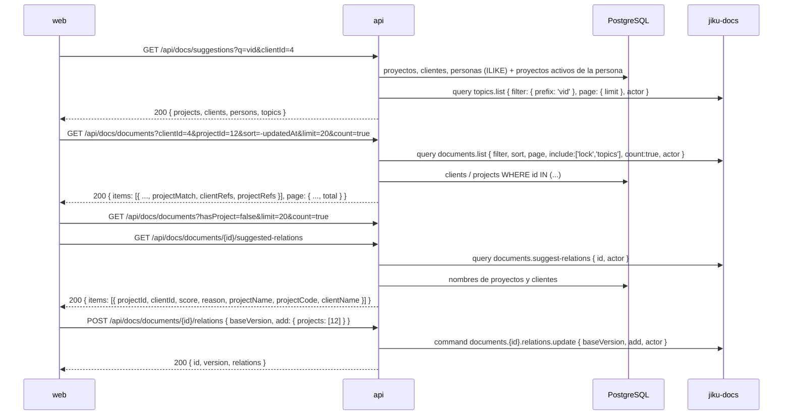

# Buscador de Documentación — Sugerencias, Resultados Filtrados y Asignación de Proyecto

**Tipo:** Feature
**Status:** Draft
**Creado:** 2026-10-26
**Última actualización:** 2026-10-26
**Stories:** S-094, S-098

## Descripción

Cómo la web (Documentación sin carpetas, REQ-021) ofrece sugerencias mientras la persona escribe, lista
los documentos filtrados por proyecto, cliente, tema, persona o visibilidad, y asigna un proyecto a un
documento "Sin proyecto". **Es el primer flujo en el que la api combina la base y el bus en una misma
ruta**: proyectos, clientes, personas y nombres salen de PostgreSQL (lectura directa, ADR-001) y los
documentos y los temas de jiku-docs, siempre con el `actor` de `buildActor`. Requiere jiku-docs >= 1.3.0.
Que el módulo esté `available` es precondición ([`descubrimiento-de-modulos`](descubrimiento-de-modulos.md)).
El recorrido general de documentos está en [`documentos-desde-la-web`](documentos-desde-la-web.md).

## Servicios Involucrados

| Servicio | Rol | Tipo de Participación |
|---|---|---|
| `web` | Buscador, lista de resultados, "Sin proyecto" y "Asignar" | Iniciador |
| `api` (`docs-suggestions-get.ts`, `docs-documents-get.ts`, `docs-documents-id-suggested-relations-get.ts`, `docs-documents-id-relations-post.ts`) | Valida forma y rol, resuelve nombres desde la base, firma como la persona | Procesador |
| PostgreSQL | Clientes, proyectos, personas, requisitos y tareas (solo lectura) | Almacenamiento |
| jiku-docs (externo) | Documentos, temas y relaciones; resuelve permisos y visibilidad | Procesador |

## Pasos del Flujo

### Paso 1: sugerencias mientras se escribe

**Request:** `GET /api/docs/suggestions?q=vid&clientId=4&limit=5`. `q` 1..100 (se recorta), `clientId`
opcional (limita **solo** proyectos), `limit` 1..10 (tope por grupo, default 5). Cadena:
`requireModule('docs')` → `hasAnyRole(['admin','user'])` → Joi → handler.

**Qué hace:** primero la base, después el bus. `projects` (nombre o código contiene `q`, los activos de la
persona primero con `mine: true`, después los `activo`, después el resto), `clients`, `persons`
(habilitadas y con usuario; `userId` es el `sub`). Los comodines de `q` se escapan. `topics` sale de
`topics.list` por **prefijo**. "Buscar «q»" y "Sin proyecto / cliente / tema" los arma la web.

**Response:** `200 { projects, clients, persons, topics }`.

### Paso 2: resultados filtrados

**Entrada desde una ficha:** el **"Ver todos ›"** de la card de documentación de un proyecto,
requisito o tarea llega a `/docs?proyecto={id}&origen=proyecto` (o `requisito` / `tarea`); el listado
pide `GET /api/docs/documents?projectId=12&sort=-updatedAt&limit=20&count=true` y ofrece "Volver" a
la ficha.

**Request:** `GET /api/docs/documents` con `projectId`/`clientId`/`topic` (listas), `hasProject`,
`hasClient`, `hasTopic`, `person`, `visibility`, `myActiveProjects`, `count`. Mismo tipo repetido = O,
tipos distintos = Y. Responde el `data` de jiku-docs con `clientRefs` y `projectRefs` por ítem. Con
`myActiveProjects=true` y sin proyectos activos responde la lista vacía sin llamar al bus.
`GET /api/docs/search` acepta los mismos filtros.

### Paso 3: asignar un proyecto

`GET .../suggested-relations` trae los candidatos con nombres; **"Asignar"** hace `POST .../relations`
con `baseVersion: item.version`. jiku-docs agrega el cliente del proyecto y crea una versión.

## Manejo de Errores

| Paso | Error | Código | Response | Comportamiento |
|------|-------|--------|----------|---------------|
| 1-3 | Módulo no instalado | 404 | `{ "code": "module_not_installed" }` | La web oculta la documentación |
| 1-3 | Módulo no disponible | 503 | `{ "code": "module_unavailable" }` | Reconsulta |
| 1-3 | jiku-docs no contestó | 504 | `{ "code": "gateway_timeout" }` | En "Asignar" pudo haberse aplicado: se refresca |
| 1-3 | Query o body inválidos | 400 | `{ "code": "invalid_fields" }` | Sin llamar al bus |
| 1 | Falla `topics.list` | el del módulo | `{ code, message }` | Sin sugerencias parciales |
| 3 | Otra persona editó antes | 409 | `{ "code": "version_conflict", "details": { "currentVersion": N } }` | Se refresca el documento |
| 3 | Documento reservado | 409 | `{ "code": "document_locked", "details": { "holder", "holderName", "via", "expiresAt" } }` | Muestra quién lo edita |
| 3 | Relación inexistente | 400 | `{ "code": "invalid_relation" }` | Mensaje en la fila |
| 3 | Id de documento malformado | 404 | `{ "code": "document_not_found" }` | Sin llamar al bus |
| 3 | Sin permiso | 403 | `{ "code": "permission_denied" }` | Aviso |

## Resultado

**Éxito:** la persona encuentra documentos por proyecto, cliente, tema o persona, y asigna un proyecto a
los que no lo tienen; el documento deja de salir en `hasProject=false`.

**Estado final:** documento con una versión nueva (`kind: update`, mensaje automático) en jiku-docs; la
base de la api sin cambios.

## Notas

- **Los temas se sugieren solo por prefijo** ("vid" encuentra "video", no "pedido-video").
- **El filtro `person` es "creado por o último editor"**: el contrato no filtra por autor de cualquier versión.
- **Sin chequeo de versión de jiku-docs en runtime:** una anterior a 1.3.0 responde `invalid_fields` a los filtros nuevos.
- Los nombres se resuelven en lote: una consulta `IN` por tipo y por respuesta, nunca por ítem.

**Origen:** REQ-021 · S-094.
