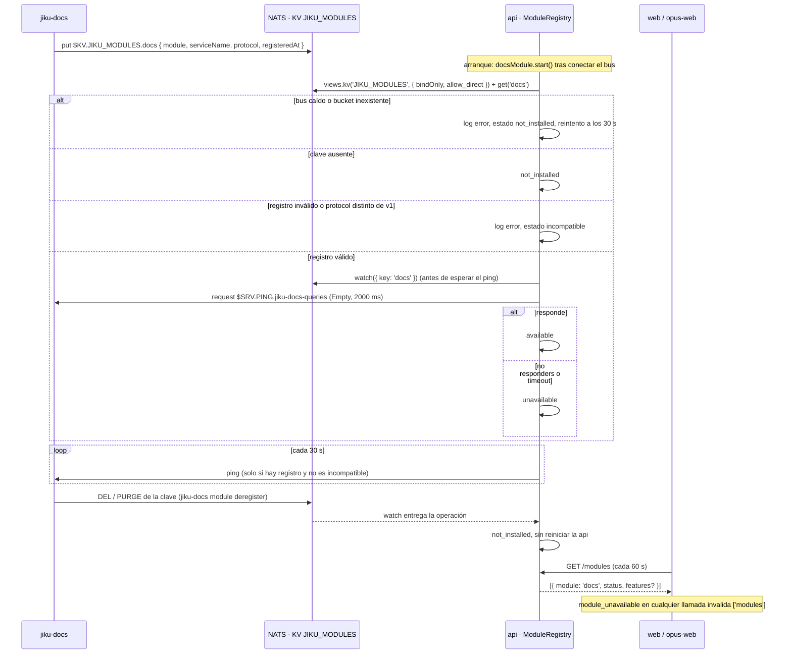

# Descubrimiento de Módulos — del Registro en el Bus al Estado que ven los Frontends

**Tipo:** Feature
**Status:** Draft
**Creado:** 2026-10-24
**Última actualización:** 2026-10-24
**Stories:** S-075, S-076, S-077, S-081, S-084, S-085

## Descripción

Cómo la api se entera de que un módulo opcional (hoy solo `docs`, servido por jiku-docs) está
instalado y vivo, y cómo ese estado llega a web y opus-web. **Es el primer flujo del producto que
nace de un registro en el bus**: no lo dispara una acción de usuario ni un comando, sino la clave
`docs` del bucket KV `JIKU_MODULES`, que el módulo escribe al arrancar.

Tiene **tres disparadores**, todos dentro de la api (`api/lib/modules/registry.ts`):

1. **El arranque de la api:** `docsModule.start()` se llama después de conectar el bus
   (`api/app.ts`), lee la clave y arma el watch.
2. **Un cambio de la clave:** el watch re-evalúa ante cada `PUT`, `DEL` o `PURGE`.
3. **El temporizador de 30 s** (`MODULE_CHECK_INTERVAL_MS = 30000`): un ping al módulo y, si el
   watch se cayó, su reapertura.

El resultado es un estado **en memoria, por réplica** de la api. La decisión y sus alternativas
están en [ADR-015](../adrs/ADR-015-modulos-opcionales-del-bus.md); este documento es el recorrido.

## Servicios Involucrados

| Servicio | Rol | Tipo de Participación |
|---|---|---|
| jiku-docs (repositorio externo) | Escribe la clave `docs` al arrancar; atiende `$SRV.PING.jiku-docs-queries`; `jiku-docs module deregister` borra la clave | Iniciador (registro) |
| NATS · KV `JIKU_MODULES` (stream `KV_JIKU_MODULES`) | Guarda el registro, historial 1, sin TTL; lo crea `deploy/nats/create-modules-kv.sh`, no la api | Almacenamiento |
| `api` (`lib/modules/registry.ts`) | Lee, observa y hace ping; calcula el estado y lo expone en `GET /modules` y `GET /opus/modules` | Procesador |
| `web` (`features/docs/hooks/useModules.ts`) | Consulta `GET /modules` cada 60 s y decide si muestra la documentación | Consumidor |
| `opus-web` (`features/docs/hooks/useModules.ts`) | Consulta `GET /opus/modules` (vía `/api/opus/modules`) cada 60 s | Consumidor |

## Pasos del Flujo



### Paso 1: jiku-docs registra el módulo

**Origen:** jiku-docs
**Destino:** NATS (KV `JIKU_MODULES`)
**Tipo:** Evento (escritura de clave)

- **Subject de escritura:** `$KV.JIKU_MODULES.docs` (solo el rol `docs`, solo esa clave).
- **Valor** (`ModuleRecord`, `packages/nats-protocol/src/index.ts`):
  ```json
  {
    "module": "string — igual a la clave del KV",
    "serviceName": "string — prefijo de los servicios micro {serviceName}-commands y {serviceName}-queries",
    "protocol": "string — versión de los contratos, ^v[0-9]+$",
    "registeredAt": "string — ISO 8601, informativo"
  }
  ```
- Un apagado normal **no** borra la clave: desinstalar es explícito (`jiku-docs module deregister`).

**Ref:** `docs/apis/jiku-modules.yaml`

---

### Paso 2: la api abre el registro (arranque)

**Origen:** api
**Destino:** NATS (KV `JIKU_MODULES`)
**Tipo:** Interno (bus)

`bus().openModuleKv()` (`api/lib/utils/bus/index.ts`) abre el bucket con
`views.kv(MODULES_BUCKET, { bindOnly: true, allow_direct: true })` y hace `get('docs')`.

- **`bindOnly`:** la api no crea el bucket (no tiene permiso ni responsabilidad; lo crea
  `deploy/nats/create-modules-kv.sh`) y bindear no consulta el stream: un bucket inexistente se ve
  recién en el primer `get()`.
- **`allow_direct: true` no es opcional:** con `bindOnly`, nats.js 2.29 deja `direct = false` y el
  `get()` iría a `$JS.API.STREAM.MSG.GET.*`, que ninguna plantilla autoriza. Las plantillas
  autorizan `$JS.API.DIRECT.GET.*`.
- **Orden:** el watch se arma **antes** de esperar el primer ping, para no perder un cambio de la
  clave mientras el ping está en vuelo (cada entrada aplicada incrementa una generación y el
  resultado de un ping solo se aplica si la generación no cambió).

**Ref:** `api/lib/modules/registry.ts` (`open()`)

---

### Paso 3: validación del registro

**Origen:** api (`parseRecord`)
**Destino:** (interno)
**Tipo:** Interno

| Condición | Estado | Log |
|---|---|---|
| Clave ausente, o operación distinta de `PUT` (`DEL`, `PURGE`) | `not_installed` | `[modules] docs: {from} -> {to}` |
| JSON ilegible, `serviceName` ausente o fuera de `^[a-z][a-z0-9-]{1,40}$`, `protocol` fuera de `^v[0-9]+$`, `module` distinto de la clave, `registeredAt` no string | `incompatible` | `[modules] docs: registro inválido ({motivo})` |
| `protocol` distinto de `SUPPORTED_PROTOCOL` (`'v1'`) | `incompatible` | `[modules] docs: protocolo {x} no soportado (soportado: v1)` |
| Registro válido | sigue al paso 4 | — |

Los campos extra se toleran (los lectores deben tolerar campos nuevos dentro de v1). Validar el
`serviceName` acá es la primera línea de defensa: un valor inválido nunca llega a
`modulePingSubject`, que lanzaría.

**Estados internos y lo que se informa hacia afuera:**

| Estado interno (`ModuleStatus`) | Se informa como (`PublicModuleStatus`) |
|---|---|
| `not_installed` | `not_installed` |
| `incompatible` | **`not_installed`** (con log de error) |
| `unavailable` | `unavailable` |
| `available` | `available` |

---

### Paso 4: ping al servicio de consultas

**Origen:** api
**Destino:** jiku-docs (framework micro de NATS)
**Tipo:** Interno (request al bus)

- **Subject:** `$SRV.PING.{serviceName}-queries` (sin instancia: es del framework micro), por
  ejemplo `$SRV.PING.jiku-docs-queries`.
- **Payload:** `Empty` (vacío), no `''`.
- **Timeout:** `MODULE_PING_TIMEOUT_MS = 2000`.
- Cualquier respuesta → `available`. `no responders` o timeout → `unavailable`; cualquier otro error
  del ping también se trata como `unavailable`.
- Un solo ping en vuelo a la vez.

**Ref:** `api/lib/utils/bus/index.ts` (`pingModule`), `packages/nats-protocol/src/index.ts`
(`modulePingSubject`)

---

### Paso 5: el watch y el temporizador

**Origen:** api
**Destino:** (interno)
**Tipo:** Interno

- **Watch:** `kv.watch({ key })`. Un `PUT` re-evalúa (pasos 3 y 4). Un `DEL` o `PURGE` deja
  `not_installed` **sin reiniciar la api**: así se aplica `jiku-docs module deregister`. El watch
  re-entrega el valor vigente al abrirse y la api **deduplica** las entradas idénticas
  (`operation:value`) para no repetir pings ni logs.
- **Cada 30 s** (`tick()`): si el handle del KV o el watch se perdieron, se reabre (paso 2); si hay
  registro y el estado no es `incompatible`, hace ping (paso 4). Un `incompatible` no se reevalúa
  por tiempo: solo cambia si la clave cambia.
- **`no responders` en una llamada de negocio:** `sendToModule` (`api/lib/modules/client.ts`) llama
  a `registry.markUnavailable()`: pasa a `unavailable` de inmediato y dispara un ping. El estado
  se recupera solo en el ping siguiente.
- **`upstream_unavailable`** (core no respondió a jiku-docs) **no** marca el módulo: es un error de
  una dependencia del módulo, no del módulo.

---

### Paso 6: el estado llega a los frontends

**Origen:** web / opus-web
**Destino:** api
**Tipo:** REST

**Request:**
- **Método:** GET
- **Endpoint:** `/api/modules` (web) · `/api/opus/modules` (opus-web; idéntico, existe porque el
  catch-all de opus-web solo reenvía `/api/opus/*`)
- **Roles:** `hasAnyRole(['admin', 'user', 'external-user'])`; sin `validateProjectPermissions`
  porque el estado de un módulo no pertenece a ningún proyecto.

**Response (éxito):**
- **Status:** 200
- **Body:**
  ```json
  [
    {
      "module": "string — 'docs'",
      "status": "string — not_installed | unavailable | available",
      "features": { "sharing": "boolean — JIKU_PUBLIC_URL definida; se omite con not_installed" }
    }
  ]
  ```

`features.sharing` sale de `docsFeatures()` (`api/lib/modules/docs/features.ts`): `true` si
`JIKU_PUBLIC_URL` está definida y no vacía, leída en cada llamada.

Los frontends:

- Consultan cada 60 s (`refetchInterval: 60_000`). **Mientras la consulta carga o falla se
  comportan como `not_installed`**: no se muestra nada de documentación.
- Ante un `module_unavailable` en cualquier llamada de docs (`withModuleInvalidation`, en ambos frontends)
  invalidan `['modules']` y vuelven a consultar sin esperar los 60 s.
- Ocultan la documentación con `not_installed`; con `unavailable` muestran un aviso.

**Ref:** `docs/apis/api.yaml` (`GET /modules`, `GET /opus/modules`)

## Manejo de Errores

| Paso | Error | Código | Response | Comportamiento |
|------|-------|--------|----------|----------------|
| 2 | Bus caído, KV inexistente o sin permiso al arrancar (DD-6) | — | log `[modules] docs: no se pudo leer el registro ({msg}); reintento en 30 s` | `start()` **nunca rechaza**: la api arranca igual con `not_installed` y reabre en el próximo tick |
| 2 | El watch termina con error | — | log `[modules] watch de JIKU_MODULES terminó con error: {msg}` | El watch nunca rechaza; el próximo tick lo reabre |
| 3 | Registro inválido | — | log `[modules] docs: registro inválido ({motivo})` | `incompatible`, visible como `not_installed` |
| 3 | `protocol` no soportado | — | log `[modules] docs: protocolo {x} no soportado (soportado: v1)` | `incompatible`, visible como `not_installed` |
| 4 | Ping sin respuesta (`no responders` o timeout 2000 ms) | — | — | `unavailable`; las rutas responden 503 `module_unavailable` y el ping vuelve a correr a los 30 s |
| 5 | `no responders` en una llamada de negocio | 503 | `{ "code": "module_unavailable", ... }` | `unavailable` inmediato + re-ping |
| 5 | `upstream_unavailable` de jiku-docs | 503 | `{ "code": "upstream_unavailable", ... }` | **No** marca el módulo |
| 6 | `GET /modules` falla o no responde | — | — | El frontend se comporta como `not_installed` |

## Resultado

**Éxito:** la api conoce el estado del módulo (`not_installed`, `unavailable` o `available`) y los
frontends muestran u ocultan la documentación en consecuencia, con una demora de hasta 30 s (ping)
más hasta 60 s (consulta del frontend).

**Estado final:**
- `ModuleRegistry` de cada réplica: estado en memoria, sin escritura en la base.
- Cada réplica de la api llega a su propio estado: dos réplicas pueden discrepar hasta 30 s.

## Notas

- **Precondición:** el bucket `JIKU_MODULES` tiene que existir antes de que el módulo se registre.
  Lo crea `deploy/nats/create-modules-kv.sh` (idempotente; `history 1`, sin TTL, `allow_direct
  true`, `storage file`, `replicas 1`), que `deploy/local.sh up` invoca y por eso **`up` requiere
  `nsc`**. `local.sh down -v` borra el volumen y el bucket.
- **La política del bus es literal:** las plantillas del auth-callout autorizan los subjects
  `jiku-docs-commands` y `jiku-docs-queries`. Un módulo registrado con otro `serviceName` arma el
  subject correcto y el bus lo rechaza. Cambiar el `serviceName` es un cambio de seguridad
  deliberado (una línea por plantilla), no un cambio de configuración. Ver
  [ADR-015](../adrs/ADR-015-modulos-opcionales-del-bus.md).
- **Permisos de lectura del registro (`KV_READ_WATCH`):** seis líneas en las plantillas `connector`,
  `docs` y las dos de persona, con la forma pelada `$JS.API.CONSUMER.CREATE.KV_JIKU_MODULES` además
  de la que lleva sufijo `.>`. La forma pelada es la que nats.js usa al recrear el consumidor
  ordenado tras un reset; sin ella el watch muere en silencio. **La lista es provisoria**: la
  verificación contra un bus real del reset del consumidor (nats.js y cliente Go) no se ejecutó. Ver
  los pendientes de verificación en el ADR.
- **Las personas no tienen ping:** una persona con token propio (jiku-go) puede leer y observar el
  registro, pero no se le concedió `$SRV.PING`, así que no puede distinguir `unavailable` de
  `available`. Solo la api calcula ese estado.
- **Contrato:** `docs/apis/jiku-modules.yaml` declara el permiso de lectura como
  `...DIRECT.GET.KV_JIKU_MODULES.$KV.JIKU_MODULES.>`; las plantillas conceden el superconjunto
  `$JS.API.DIRECT.GET.KV_JIKU_MODULES.>` (solo lectura).
- **Lo que el ping no dice:** `available` significa que el servicio micro `*-queries` respondió al
  ping, no que jiku-docs pueda atender cualquier operación (por ejemplo, puede no poder hablar con
  core: eso es `upstream_unavailable`).
- Este flujo no documenta las llamadas de negocio a jiku-docs: son
  [`documentos-desde-la-web`](documentos-desde-la-web.md) y
  [`lectura-por-link-compartido`](lectura-por-link-compartido.md).

**Origen:** REQ-016 · stories S-075 (contrato y permisos del bus), S-076 (core: rol `docs`), S-077
(el registro de la api), S-081 (consumo en web), S-084 (consumo en opus-web), S-085 (esta
documentación).
