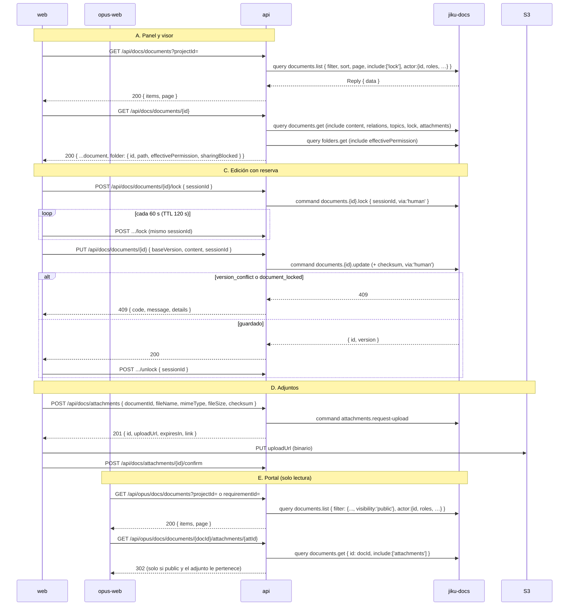

# Documentos desde la Web — Panel, Visor, Edición con Reserva, Adjuntos y Portal en Solo Lectura

**Tipo:** Feature
**Status:** Draft
**Creado:** 2026-10-24
**Última actualización:** 2026-10-25
**Stories:** S-077, S-078, S-079, S-081, S-082, S-084, S-085, S-087, S-088, S-089

## Descripción

Cómo una persona lee y edita documentación desde `web`, y cómo un usuario del portal la lee desde
`opus-web`, con jiku-docs como dueño de los datos. **Es el primer flujo en el que la api LEE por el
bus** en vez de leer su base: la documentación no está en PostgreSQL, así que `GET /api/docs/*`
publica consultas a `jiku-docs-queries` y las escrituras publican comandos a `jiku-docs-commands`.
Es la segunda excepción a ADR-001 (ver [ADR-015](../adrs/ADR-015-modulos-opcionales-del-bus.md)).

Todas las llamadas se hacen **en nombre de la persona**, con el `actor` de `buildActor` (`{ id, roles,
name?, username?, email? }`, el mismo sobre que recibe core), por el embudo
`api/lib/modules/client.ts`. La api **no autoriza el dominio**: jiku-docs clasifica a la persona con
los `roles` de ese `actor` (D-11) y resuelve el ACL de carpetas. Requiere jiku-docs con D-11 (ADR-015,
R-9). Que el módulo esté `available` es precondición de todo el
flujo: [`descubrimiento-de-modulos`](descubrimiento-de-modulos.md).

Cubre: (A) panel en una ficha, (B) visor, (C) edición con reserva y conflicto de versión, (D)
adjuntos, (E) lectura desde el portal. La lectura anónima por link es otro flujo:
[`lectura-por-link-compartido`](lectura-por-link-compartido.md).

## Servicios Involucrados

| Servicio | Rol | Tipo de Participación |
|---|---|---|
| `web` (`features/docs/`) | Panel, visor, editor, zona de adjuntos; Server Actions que llaman a la api con el token de sesión | Iniciador |
| `opus-web` (`features/docs/`) | Lista y detalle de documentos `public` del portal; solo lectura | Iniciador |
| `api` (`lib/routes/docs-*.ts`, `opus-docs-*.ts`, `lib/modules/`) | Valida rol y forma, firma como la persona (`actor` de `buildActor`), traduce el sobre `Reply` a HTTP | Procesador |
| NATS (`jiku-docs-queries`, `jiku-docs-commands`) | Transporte de consultas y comandos | Transporte |
| jiku-docs (externo) | Dueño de documentos, carpetas, versiones, reservas y adjuntos; resuelve permisos | Procesador |
| `core` | jiku-docs le pide el rol y permisos de la persona y el vínculo de archivos; no habla con la web | Procesador (indirecto) |
| S3 / MinIO | Almacena adjuntos y contenidos grandes; el binario va directo desde el navegador | Almacenamiento |

## Pasos del Flujo



### Paso 1: panel de documentos en una ficha (web)

**Origen:** web (`DocsPanel`, montado en `projects/[id]`, `objectives/[id]` y el detalle de
requisito)
**Destino:** api → jiku-docs
**Tipo:** REST + Consulta por el bus

El panel solo se renderiza si `useModule('docs')` no es `not_installed`. Su Server Action
`listDocuments` (`features/docs/services/docsApi.ts`) llama a la api con el token de sesión.

**Request:**
- **Método:** GET
- **Endpoint:** `/api/docs/documents`
- **Query:** `projectId`, `requirementId`, `taskId`, `clientId`, `folderId`, `pathPrefix`, `topic`,
  `sort` (default `-updatedAt`), `limit` (1..`PAGE_LIMIT_MAX`, default 50; el panel pide 10),
  `cursor`. Las claves no declaradas son 400 `invalid_fields`.
- **Cadena:** `requireModule('docs')` → `hasAnyRole(['admin','user'])` → Joi → handler.

**Consulta al bus:**
- **Subject:** `{instance}.{apiUserId}.jiku-docs-queries.v1.documents.list`
- **Payload:** `{ filter, sort: [sort], page, include: ['lock'], actor: { id, roles, name?, username?, email? } }`

**Response (éxito):** `200` con el `data` de jiku-docs **sin transformar** (`{ items, page }`;
`page.cursor` pagina).

**Ref:** `docs/apis/api.yaml` (`GET /docs/documents`)

---

### Paso 2: visor de un documento (web)

**Origen:** web (`DocumentView`, página `/docs/[id]`)
**Destino:** api → jiku-docs
**Tipo:** REST + dos consultas por el bus

**Request:** `GET /api/docs/documents/{id}` (query opcional `version`).

La api valida que `{id}` sea un ULID **antes** de tocar el bus (un id mal formado responde 404
`document_not_found`, igual que uno inexistente). Después compone dos consultas en serie, la única
composición de la api:

1. `documents.get { id, include: ['content','relations','topics','lock','attachments'] }`
2. `folders.get { id: document.folderId, include: ['effectivePermission'] }`

**Response (éxito):** `200`
```json
{
  "...document": "lo que devuelve documents.get",
  "folder": {
    "id": "string",
    "path": "string",
    "effectivePermission": "string — read | write | manage",
    "sharingBlocked": "boolean"
  }
}
```

La web decide con `folder.effectivePermission` si ofrece editar (`write` o `manage`) o compartir
(`manage`, con `features.sharing`). **Un documento con `contentUrl` (más de 256 KiB) se muestra en
solo lectura**: la Server Action `getDocument` descarga el contenido **del lado del servidor** y la
interfaz no ofrece editar.

**Ref:** `docs/apis/api.yaml` (`GET /docs/documents/{id}`)

---

### Paso 3: tomar la reserva de edición (web)

**Origen:** web (`useEditSession`)
**Destino:** api → jiku-docs
**Tipo:** REST + Comando por el bus

Al entrar en edición la web genera un `sessionId` (ULID) **nuevo** y toma la reserva.

**Request:**
- **Método:** POST
- **Endpoint:** `/api/docs/documents/{id}/lock`
- **Body:**
  ```json
  {
    "sessionId": "string — ULID, requerido",
    "ttlSeconds": "number — 30..300, opcional"
  }
  ```

**Comando al bus:** `documents.{id}.lock { sessionId, ttlSeconds?, via: 'human', actor }`.

**Response (éxito):** `200` con el `data` de jiku-docs. La reserva dura **120 s** en jiku-docs.

**Ref:** `docs/apis/api.yaml` (`POST /docs/documents/{id}/lock`)

---

### Paso 4: renovar la reserva mientras se edita (web)

**Origen:** web
**Destino:** api → jiku-docs
**Tipo:** REST + Comando por el bus

Cada **60 s** (`RENEW_INTERVAL_MS = 60_000`) la web repite el mismo `POST .../lock` con el
**mismo `sessionId`**. Si la renovación falla, la fase pasa a `lost` y la interfaz lo avisa; si el
error es `document_locked`, se muestra quién tiene la reserva (`details.holder`, `details.via`,
`details.expiresAt`, verbatim).

---

### Paso 5: guardar con versión base (web)

**Origen:** web (`DocumentEditor`, `useSaveDocument`)
**Destino:** api → jiku-docs
**Tipo:** REST + Comando por el bus

**Request:**
- **Método:** PUT
- **Endpoint:** `/api/docs/documents/{id}`
- **Body** (Joi `strict`):
  ```json
  {
    "baseVersion": "number — entero >= 1, requerido; la versión sobre la que se edita",
    "content": "string — Markdown, puede ser ''",
    "sessionId": "string — ULID de la sesión que tiene la reserva, opcional",
    "message": "string — mensaje de la versión, opcional"
  }
  ```

**Comando al bus:** `documents.{id}.update { baseVersion, content, sessionId?, message?, checksum,
via: 'human', actor }`. El `checksum` lo **calcula la api** del texto (`contentChecksum`,
`sha256:` + hex); `via` lo fija la api (toda escritura por HTTP es una persona en la web).

**Response (éxito):** `200 { id, version, path?, warnings? }`. Si `warnings` incluye
`possible_secret_detected`, la web avisa que el texto parece contener una clave.

Al guardar bien, la web libera la reserva (Paso 6). **Sin reintento automático**: un 504 significa
"pudo haberse aplicado".

**Ref:** `docs/apis/api.yaml` (`PUT /docs/documents/{id}`)

---

### Paso 6: liberar la reserva (web)

**Origen:** web
**Destino:** api → jiku-docs
**Tipo:** REST + Comando por el bus

- **Al guardar, cancelar o descartar:** Server Action `unlockDocument` → `POST
  /api/docs/documents/{id}/unlock` con `{ sessionId }` (comando `documents.{id}.unlock`).
- **Al cerrar la pestaña o navegar fuera (`pagehide`) y al desmontar el editor:** un Server Action
  no corre mientras la página se descarga, así que la web hace `fetch` con **`keepalive: true`** al
  BFF `POST /api/docs/documents/{id}/unlock` (`web/src/app/api/docs/documents/[id]/unlock/route.ts`),
  que valida sesión y ULIDs y reenvía **solo** `{ sessionId }` (`force` nunca se expone). Si el
  pedido no llega, la reserva vence sola a los 120 s.

**Ref:** `docs/apis/api.yaml` (`POST /docs/documents/{id}/unlock`)

---

### Paso 7: subir un adjunto (web)

**Origen:** web (`DocumentAttachZone`, `uploadDocAttachment`)
**Destino:** api → jiku-docs → S3
**Tipo:** REST + Comando por el bus + PUT directo

1. **Checksum en el navegador** (`sha256Checksum`): solo quien tiene el archivo puede calcularlo, y
   el binario nunca pasa por Next ni por la api.
2. `POST /api/docs/attachments`:
   ```json
   {
     "id": "string — ULID, opcional (si falta lo genera la api)",
     "documentId": "string — ULID, requerido",
     "fileName": "string — requerido",
     "mimeType": "string — requerido",
     "fileSize": "number — entero >= 1, requerido",
     "checksum": "string — ^sha256:[0-9a-f]{64}$, requerido"
   }
   ```
   La api publica `attachments.request-upload` y responde `201 { id, uploadUrl, expiresIn, link }`.
3. **`PUT` a `uploadUrl`** directo a S3 (la URL prefirmada no se loguea).
4. `POST /api/docs/attachments/{id}/confirm` (cuerpo vacío) → comando `attachments.{id}.confirm`.
5. La web inserta en el editor el enlace Markdown con el `link` **absoluto** que devolvió jiku-docs:
   `` para imágenes y `[nombre](link)` para el resto. `link` es
   `{JIKU_WEB_URL}/docs/attachments/{id}`.

El archivo queda **sin vínculo** en `core` (no hay `file_link`): ver
[`subida-de-archivos`](subida-de-archivos.md) (canal alternativo).

**Ref:** `docs/apis/api.yaml` (`POST /docs/attachments`, `POST /docs/attachments/{id}/confirm`)

---

### Paso 8: leer un adjunto (web)

**Origen:** navegador
**Destino:** web → api → jiku-docs → S3
**Tipo:** REST (302 propagado)

El enlace `{JIKU_WEB_URL}/docs/attachments/{id}` lo atiende el route handler
`web/src/app/docs/attachments/[id]/route.ts`, **fuera** de `(loggedin)` (no hay guard de layout:
valida la sesión por sí mismo). Llama a `GET /api/docs/attachments/{id}` con `redirect: 'manual'`;
la api publica `attachments.{id}.request-download` y responde **302** con `Location` = `downloadUrl`
y `X-Content-Type-Options: nosniff`. La web **propaga** el 302: el navegador baja el archivo directo
de S3, sin proxy del binario.

**Ref:** `docs/apis/api.yaml` (`GET /docs/attachments/{id}`)

---

### Paso 9: lectura desde el portal (opus-web)

**Origen:** opus-web (`DocsSection`, `DocumentView`)
**Destino:** api → jiku-docs
**Tipo:** REST + Consulta por el bus

opus-web habla con la api por el catch-all `/api/opus/[...path]`. Solo hay lectura: no edita,
no busca, no comparte.

| Operación | Endpoint | Detalle |
|---|---|---|
| Listar | `GET /api/opus/docs/documents` | Query `projectId` **o** `requirementId` (uno solo); `limit`, `cursor`. Cadena: `requireModule` → `hasAnyRole(['external-user','admin','user'])` → forma → `loadDocsScope` → `validateProjectPermissions` → `validateRequirementIsPublic` (solo si filtra por requisito) → handler. **`filter.visibility: 'public'` lo fuerza el handler**; la query no puede pisarlo |
| Detalle | `GET /api/opus/docs/documents/{id}` | `documents.get { id, include: ['content','attachments'] }`; **404 `document_not_found` si `visibility !== 'public'`** (falla cerrado) |
| Adjunto | `GET /api/opus/docs/documents/{documentId}/attachments/{id}` | `documents.get { id: documentId, include: ['attachments'] }`; **404 `document_not_found` si `visibility !== 'public'`** (todo rol, también `admin`/`user`); **404 `attachment_not_found` si `id` no está en `attachments[].id`**; recién entonces `attachments.{id}.request-download` → 302 a la URL prefirmada |

Los adjuntos se enlazan por el handler propio
`opus-web/src/app/api/docs/documents/[documentId]/attachments/[id]/route.ts`: el navegador no puede
mandar el token en un `src`/`href` y el catch-all sigue las redirecciones (convertiría el 302 en un
proxy del binario). El handler valida la sesión, valida **los dos** ULID (404 `document_not_found` /
`attachment_not_found`, en el orden del path), llama a
`api/opus/docs/documents/{documentId}/attachments/{id}` con **`redirect: 'manual'`** y propaga el 302
(solo `GET`). Un 401 responde `{ "code": "unauthorized", "message": "Unauthorized" }`.

El visor arma la URL con `createDocsUrlTransform(doc.id)` y la lista de adjuntos con el `documentId`
del adjunto, así que un enlace al adjunto de **otro** documento queda bajo el documento abierto y
responde 404 (R-3 de REQ-017, sin tratamiento visible).

Un documento con `contentUrl` (más de 256 KiB) se descarga **desde el navegador** (a diferencia de
web, que lo hace del lado del servidor): requiere CORS `GET` en el bucket de jiku-docs.

**Ref:** `docs/apis/api.yaml` (`GET /opus/docs/documents`, `GET /opus/docs/documents/{id}`,
`GET /opus/docs/documents/{documentId}/attachments/{id}`)

## Manejo de Errores

Cuerpo de error de módulo: `{ code, message, details? }`, con `code` = `errorCode` de jiku-docs sin
traducir y `details` verbatim (la clave no existe si no viene). Mapa completo en
`api/lib/modules/docs/errors.ts`.

| Paso | Error | Código | Response | Comportamiento |
|------|-------|--------|----------|---------------|
| 1-9 | Módulo no instalado | 404 | `{ "code": "module_not_installed" }` | `requireModule` corta antes de `hasAnyRole`; la web oculta la documentación |
| 1-9 | Módulo no disponible | 503 | `{ "code": "module_unavailable" }` | La web invalida `['modules']` y reconsulta sin esperar los 60 s |
| 1-9 | jiku-docs no contestó a tiempo | 504 | `{ "code": "gateway_timeout" }` | Sin reintento en escrituras (pudo aplicarse) |
| 1-9 | Sin identidad verificada | 401 | `{ "code": "unauthorized" }` | **Falla cerrado, sin publicar**: sin `actor` jiku-docs trataría la llamada como el propio servicio |
| 2-9 | Id de path malformado | 404 | `*_not_found` | No llama al bus |
| 1-8 | Sin permiso sobre la carpeta | 403 | `{ "code": "permission_denied" }` | La web lo muestra como error de permiso; al guardar pasa el editor a solo lectura |
| 5 | Otra persona guardó antes | 409 | `{ "code": "version_conflict", "details": { "currentVersion": N } }` | La web **conserva el texto de la persona**, trae la versión actual, avisa quién guardó y nunca reintenta sola: la persona decide guardar sobre la versión actual |
| 3, 5 | Reserva en poder de otra sesión | 409 | `{ "code": "document_locked", "details": { "holder", "via", "expiresAt" } }` | La web muestra quién tiene la reserva; no se pierde el texto |
| 4 | La renovación falla (reserva vencida o tomada por otra sesión, u otro error) | 409 u otro | `document_locked` con `details`, u otro código | La fase pasa a `lost`; el texto sigue en el editor |
| 3-5 | Alta con nombre repetido, o nombre inválido | 409 / 400 | `already_exists` / `file_name_invalid` | Error junto al campo en el alta |
| 5 | Frontmatter o vínculo inválido | 400 | `frontmatter_invalid` / `invalid_relation` | Mensaje bajo el editor |
| 5 | Contenido supera 256 KiB | 400 | `{ "code": "content_too_large" }` | Mensaje bajo el editor |
| 3-7 | **Cuerpo supera 768 KiB** | 413 | `{ "code": "payload_too_large" }` | Lo responde el manejador de errores de `app.ts` antes de llegar a la ruta, sin llamar al bus. El tope de `/api/docs` es `768kb` solo para `POST`/`PUT`; el resto de la api conserva 100 kb |
| 7 | Tipo o tamaño de adjunto no permitido | 400 | `attachment_type_not_allowed` / `attachment_too_large` | Mensaje en la zona de adjuntos |
| 7 | URL de subida prefirmada vencida | — (la rechaza S3) | — | La web pide volver a intentarlo (`expired_upload_url`, código propio de la web) |
| 7 | Adjuntos no configurados en jiku-docs | 503 | `{ "code": "attachments_not_configured" }` | Error de sistema |
| 9 | Documento no `public` (documento o adjunto; todo rol) | 404 | `{ "code": "document_not_found" }` | Idéntico a un id inexistente; vale también para el adjunto, incluso para `admin`/`user` |
| 9 | Adjunto que no pertenece al documento pedido | 404 | `{ "code": "attachment_not_found" }` | Incluye el adjunto de otro documento `public`; el portal no lo trata visiblemente (R-3) |
| 9 | Handler de adjunto sin sesión | 401 | `{ "code": "unauthorized", "message": "Unauthorized" }` | El navegador recibe el 401 del handler |

## Resultado

**Éxito:** la persona ve la lista de documentos de su ficha, abre uno, lo edita con una reserva que
evita pisadas, guarda una versión nueva y adjunta imágenes o archivos que quedan enlazados desde el
Markdown. El usuario del portal ve los documentos `public` de su proyecto o requisito.

**Estado final:**
- Documento: una versión nueva en jiku-docs (con `via: "human"`).
- Reserva: liberada (o vence sola a los 120 s).
- Adjunto: subido a S3 y confirmado, sin vínculo en `core`.
- Base de la api: sin cambios (la documentación no está en ella).

## Notas

- **Patrón `DocsResult` en web:** todas las Server Actions de docs devuelven `{ ok: true; data } |
  { ok: false; error }` y los hooks re-lanzan con `unwrap`, porque un error lanzado desde un Server
  Action llega al navegador sin `code` ni `details` en el build de producción, justo en los flujos
  que dependen de ellos (`document_locked`, `version_conflict`). `getModules` es la excepción.
- **El alta sin `id` no es idempotente:** si la api genera el ULID y el cliente reintenta tras un
  504, se crea un documento nuevo. Los documentos de más de 256 KiB no se crean ni editan por HTTP
  (no hay `contentUploadId`).
- **Fuera de la interfaz** aunque la api los expone: historial (`GET .../versions`), mover,
  restaurar y borrar documentos. La administración de carpetas y ACL no está en este producto
  (jiku-go). opus-web no edita, no busca y no comparte.
- **Sin tiempo real en el navegador:** `docs-notify` no llega a la web; los cambios de otra persona
  se ven al refrescar o al guardar (conflicto).
- **Topes de la web:** la raíz de `/docs` lee hasta 10 páginas de 200 carpetas (~2000); la búsqueda
  no pagina (hasta 50 resultados); la lista de links de un documento trae una página de 200.
- **Excepciones anotadas:** el detalle por id del portal, y también la ruta del adjunto, no aplican
  `validateProjectPermissions` (el proyecto no se conoce antes de pedir el documento; cubre la regla
  de externos de jiku-docs). El adjunto del portal se pide bajo su documento y la api verifica
  `public` y pertenencia antes de generar la descarga: REQ-017 (S-087) cerró la brecha F-13. Ver
  [ADR-015](../adrs/ADR-015-modulos-opcionales-del-bus.md).
- **Lo que este flujo no documenta:** la resolución de permisos dentro de jiku-docs (consulta a
  `core`), documentada en el repositorio de jiku-docs.

**Origen:** REQ-016 · stories S-077 (cliente de módulos), S-078 y S-079 (rutas de lectura y
escritura de la api), S-081 (panel y visor de web), S-082 (editor con reserva, carpetas, búsqueda y
adjuntos), S-084 (opus-web), S-085 (esta documentación) · REQ-017 · S-087 (adjunto del portal bajo su documento) · S-088 (413 en JSON) · REQ-019 · S-089 (`actor` completo hacia jiku-docs).
