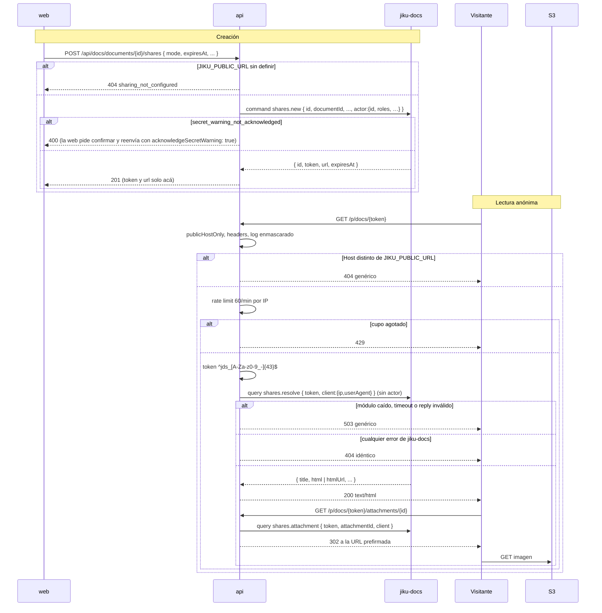

# Lectura por Link Compartido — Creación del Link en la Web y Lectura Anónima por el Host Público

**Tipo:** Feature
**Status:** Draft
**Creado:** 2026-10-24
**Última actualización:** 2026-10-25
**Stories:** S-075, S-079, S-080, S-083, S-085, S-089

## Descripción

Cómo una persona con permiso `manage` crea un link público de solo lectura a un documento, y cómo
un visitante **sin credencial** lo lee en `{JIKU_PUBLIC_URL}/p/docs/{token}`. **Es la primera ruta
pública del producto que responde HTML** y la única sin credencial (`config/public.ts` tiene una
sola exención: `get: ['p/docs/']`). Por eso su control de acceso no es un rol sino una cadena de
defensas, y todo lo que falla se ve igual para el visitante.

El visitante nunca habla con jiku-docs: habla con la api, que consulta a jiku-docs por el bus **sin
`actor`** (no hay persona) y con los datos del cliente (`client`) para la auditoría de accesos. La
decisión está en [ADR-015](../adrs/ADR-015-modulos-opcionales-del-bus.md).

## Servicios Involucrados

| Servicio | Rol | Tipo de Participación |
|---|---|---|
| `web` (`ShareDocumentDialog`, `ShareLinksTable`) | Crea, lista y revoca links; muestra el link una sola vez | Iniciador (creación) |
| Visitante anónimo (navegador) | Abre el link | Iniciador (lectura) |
| `api` (`lib/public-routes/`, `lib/modules/docs/public-*`) | Cadena de la ruta pública, página HTML, cabeceras | Procesador |
| NATS (`jiku-docs-commands`, `jiku-docs-queries`) | Transporte | Transporte |
| jiku-docs (externo) | Genera y valida el token (guarda su hash), sanea el HTML, audita accesos | Procesador |
| S3 / MinIO | Aloja imágenes y, para documentos grandes, el HTML prefirmado | Almacenamiento |

**Quién NO participa en la lectura:** `core` y la base de la api. La lectura anónima no consulta
permisos de persona.

## Pasos del Flujo



### Paso 1: crear el link (web)

**Origen:** web (`ShareDocumentDialog`, `useCreateShare`)
**Destino:** api → jiku-docs
**Tipo:** REST + Comando por el bus

El botón de compartir solo aparece si `features.sharing` (de `GET /modules`: `JIKU_PUBLIC_URL`
definida) **y** `document.folder.effectivePermission === 'manage'`. `folder.sharingBlocked` se lee
**al abrir** el diálogo: si la carpeta bloquea compartir, el diálogo lo dice y no ofrece crear.

**Request:**
- **Método:** POST
- **Endpoint:** `/api/docs/documents/{id}/shares`
- **Body** (Joi `strict`):
  ```json
  {
    "id": "string — ULID, opcional (si falta lo genera la api)",
    "mode": "string — latest | pinned, requerido",
    "version": "number — entero >= 1; obligatoria con pinned (la valida jiku-docs)",
    "expiresAt": "string — ISO 8601, futuro y como máximo 180 días, requerido",
    "includeAttachments": "boolean",
    "note": "string",
    "acknowledgeSecretWarning": "boolean"
  }
  ```
- `expiresAt` lo calcula la Server Action de web con el reloj del servidor de Next a partir de la
  opción elegida: **7, 15, 30, 90 o 180 días** (default 30).

**Comando al bus:** `shares.new { id, documentId, mode, version?, expiresAt, includeAttachments?,
note?, acknowledgeSecretWarning?, actor }`. `actor` es el de `buildActor` (`{ id, roles, name?, username?, email? }`), como en [`documentos-desde-la-web`](documentos-desde-la-web.md).

**Response (éxito):**
- **Status:** 201
- **Body:**
  ```json
  {
    "id": "string",
    "token": "string — jds_ + 43 caracteres",
    "url": "string — {JIKU_PUBLIC_URL}/p/docs/{token}",
    "expiresAt": "string — ISO 8601"
  }
  ```

**El `token` y la `url` solo existen en esta respuesta**: la web los muestra **una sola vez** (con
botón de copiar), no los reconsulta y la mutación no los retiene (`gcTime: 0`). Ningún log de la
api los registra.

**Si el documento parece contener un secreto** jiku-docs responde 400
`secret_warning_not_acknowledged`: la web pide confirmación y, si la persona acepta, reenvía la
misma solicitud con `acknowledgeSecretWarning: true`.

**Ref:** `docs/apis/api.yaml` (`POST /docs/documents/{id}/shares`)

---

### Paso 2: listar y revocar links (web)

**Origen:** web (`ShareLinksTable`)
**Destino:** api → jiku-docs
**Tipo:** REST + Consulta/Comando por el bus

- **Listar:** `GET /api/docs/documents/{id}/shares` (query `status` = `active` | `revoked` |
  `expired`, `limit` 1..200, `cursor`) → consulta `shares.list { filter: { documentId, status? },
  sort: ['-createdAt'], page }`. **La lista nunca incluye el token.** El estado lo informa la api;
  la web no lo recalcula.
- **Revocar:** `DELETE /api/docs/shares/{id}` → comando `shares.{id}.revoke`, responde `200 { id,
  revokedAt }`. No comprueba `features.sharing`: revocar un link existente tiene que seguir siendo
  posible aunque la instalación deje de publicar links.

**Ref:** `docs/apis/api.yaml` (`GET /docs/documents/{id}/shares`, `DELETE /docs/shares/{id}`)

---

### Paso 3: el visitante abre el link (cadena de la ruta pública)

**Origen:** navegador del visitante
**Destino:** api
**Tipo:** REST (HTML)

`GET {JIKU_PUBLIC_URL}/p/docs/{token}`. Orden real, de afuera hacia adentro
(`api/app.ts`, `api/lib/public-routes/index.ts`):

1. **`publicHostOnly`, primer middleware de la app:** en el host de `JIKU_PUBLIC_URL` solo pasan
   `GET` y `HEAD` de `/p/docs/<algo>`; todo lo demás recibe un 404 genérico **antes** de
   `validateToken` y del logger (un `GET /api/clients` en ese host no revela que hay una api).
2. `publicDocsHeaders`: las cinco cabeceras de abajo, en **toda** respuesta.
3. `publicDocsAccessLog`: una línea por pedido con el token enmascarado (`/p/docs/jds_…`). El
   logger de requests ignora `/p/docs/*` (la URL lleva el token). Nunca se loguea IP, User-Agent,
   título ni contenido.
4. `requirePublicHost`: sin `JIKU_PUBLIC_URL`, o `Host` distinto → 404 genérico sin llamar a nada.
   Se compara contra el `Host` **crudo**, nunca contra `X-Forwarded-Host`.
5. `publicDocsRateLimit` (`express-rate-limit`): **60 pedidos por 60 s por IP** (`windowMs 60000`,
   `limit 60`, `standardHeaders: 'draft-8'`), `MemoryStore` **por réplica**. Un solo limitador para
   la página y sus imágenes. Excedido → **429**.
6. Handler: el token tiene que cumplir **`^jds_[A-Za-z0-9_-]{43}$`**; si no, 404 **sin tocar el
   bus**.
7. Estado del módulo: `not_installed` o `incompatible` → 404 genérico; `unavailable` → **503**
   genérico.
8. `shares.resolve` (Paso 4).

La IP viene de `req.ip`: detrás del ingress hay que definir `API_TRUST_PROXY`, o todos los
visitantes compartirían un único cupo.

**Cabeceras de toda respuesta** (`PUBLIC_DOCS_HEADERS`, `api/lib/modules/docs/public-page.ts`):

```
Content-Security-Policy: default-src 'none'; img-src 'self' https: data:; style-src 'unsafe-inline'; base-uri 'none'; form-action 'none'; frame-ancestors 'none'
X-Robots-Tag: noindex
Referrer-Policy: no-referrer
Cache-Control: private, no-store
X-Content-Type-Options: nosniff
```

`img-src` admite `https:` porque las imágenes redirigen (302) a S3 y la CSP también se evalúa
contra el destino. `Referrer-Policy: no-referrer` evita que el token viaje como `Referer` al
storage.

---

### Paso 4: resolver el token en jiku-docs

**Origen:** api
**Destino:** jiku-docs
**Tipo:** Consulta por el bus

**Consulta:** `shares.resolve`, **sin `actor`**:
```json
{
  "token": "string — jds_…",
  "client": {
    "ip": "string — hasta 100 caracteres",
    "userAgent": "string — hasta 2000 caracteres"
  }
}
```
Las claves de `client` ausentes se omiten; se trunca a los máximos del contrato (mandar más sería
`invalid_fields` y el link se vería como inválido). Va por `sendToModule` (no por `moduleQuery`)
porque la ruta responde HTML, no JSON.

**Reply (`data`):** `{ shareId, documentId, title, version, html?, htmlUrl?, attachments? }`.

- `html` → se usa tal cual (lo sanitizó jiku-docs; la api no re-sanitiza ni parsea Markdown).
- `htmlUrl` (documento grande, URL prefirmada que vence a los 300 s) → la api lo descarga
  (`http`/`https`, hasta 5 MiB, timeout 10 s, sin redirecciones, solo `200`).
- Un reply sin `html` ni `htmlUrl` → 503 y log sin URL.

La respuesta es la plantilla mínima de `renderSharedDocument`: sin scripts, sin enlaces a la
aplicación, sin marca. **Status 200, `text/html`.**

---

### Paso 5: imágenes y adjuntos de la página

**Origen:** navegador del visitante
**Destino:** api → jiku-docs → S3
**Tipo:** REST (302)

`GET /p/docs/{token}/attachments/{id}`: pasa por la **misma cadena** (mismo cupo) y valida el token
y que `{id}` sea ULID. Consulta `shares.attachment { token, attachmentId, client }`, sin `actor`, y
responde **302** a `downloadUrl` con `X-Content-Type-Options: nosniff` y las cinco cabeceras.

**Ref:** `docs/apis/api.yaml` (`GET /p/docs/{token}`, `GET /p/docs/{token}/attachments/{id}`)

## Manejo de Errores

| Paso | Error | Código | Response | Comportamiento |
|------|-------|--------|----------|---------------|
| 1 | `JIKU_PUBLIC_URL` sin definir | 404 | `{ "code": "sharing_not_configured", "message": "Los links compartidos no están configurados" }` | La web invalida `['modules']` y avisa que compartir no está habilitado |
| 1 | Carpeta con compartir bloqueado | 403 | `{ "code": "sharing_blocked" }` | El diálogo muestra el estado bloqueado |
| 1 | Documento con posible secreto | 400 | `{ "code": "secret_warning_not_acknowledged" }` | Confirmación y reenvío con `acknowledgeSecretWarning: true` |
| 1 | Vencimiento fuera de rango | 400 | `{ "code": "share_expiry_invalid" }` | Error junto al campo (7 a 180 días) |
| 1 | Sin permiso | 403 | `{ "code": "permission_denied" }` | Aviso en el diálogo |
| 1 | Un 504 al crear | 504 | `{ "code": "gateway_timeout" }` | El link **pudo haberse creado**: la lista se refresca y no se reintenta solo (el alta sin `id` no es idempotente) |
| 2 | Link ya inexistente al revocar | 404 | `{ "code": "share_not_found" }` | La web refresca la lista sin mensaje |
| 3 | `Host` distinto del público, o método distinto de `GET`/`HEAD` en el host público | 404 | página HTML genérica | Sin llamar al bus |
| 3 | Cupo agotado | 429 | página HTML "Demasiados intentos" | El visitante espera un minuto |
| 3 | Token con forma inválida | 404 | página HTML genérica | Sin llamar al bus |
| 3 | Módulo `not_installed` o `incompatible` | 404 | la misma página | Idéntico a un link inexistente |
| 3 | Módulo `unavailable` | 503 | página HTML "El documento no está disponible en este momento" | Genérico |
| 4 | Link revocado, vencido o inexistente (`share_not_found` u **otro** error de jiku-docs) | 404 | **la misma página** | Solo se loguea el código del error, nunca el mensaje ni el token; `share_not_found` ni siquiera se loguea |
| 4 | Timeout o bus inalcanzable | 503 | página genérica | `sendToModule` ya logueó; `no responders` marca el módulo `unavailable` |
| 4 | Falla la descarga de `htmlUrl`, o reply sin `html` ni `htmlUrl` | 503 | página genérica | Log sin la URL |
| 5 | Adjunto o link inválido | 404 | página genérica | Idéntico para cualquier causa |

## Resultado

**Éxito (creación):** la persona copia un link `{JIKU_PUBLIC_URL}/p/docs/{token}` que no podrá ver
de nuevo; aparece en la lista (sin token) con su estado.

**Éxito (lectura):** el visitante ve la página del documento, en solo lectura, con las imágenes del
documento si las incluye el link.

**Estado final:**
- jiku-docs: link creado (con el hash del token) y un acceso auditado por cada lectura con `client`.
- api: sin escrituras; solo una línea de log por pedido con el token enmascarado.

## Notas

- **El 404 es uno solo.** Revocado, vencido, inexistente, host equivocado, token mal formado y
  `JIKU_PUBLIC_URL` sin configurar se ven idénticos: la página no revela si un link existió.
- **Página e imágenes comparten el cupo de 60/min:** un documento con más de ~59 imágenes agota el
  cupo en una sola carga.
- **El cupo es por réplica** (`MemoryStore`): con N réplicas el límite efectivo es 60·N por minuto.
- **`HEAD /p/docs/{token}` llama a `shares.resolve`** y suma un acceso a la auditoría.
- **CORS:** `cors()` corre antes del router público, así que `Access-Control-Allow-Origin: *` llega
  también a `/p/docs/*`. No amplía la exposición (la ruta es pública), pero está.
- **En local las imágenes no cargan:** la CSP exige `https:` y el 302 apunta a MinIO por `http`.
- **Configuración del host público:** `DOCS_PUBLIC_DOMAIN` tiene que ser un **host propio** (no el
  de la api) y el certificado SAN único requiere que el DNS exista primero. `JIKU_PUBLIC_URL` es
  solo el origen: `assertPublicUrlConfig` corta el arranque si no es URL, no es `http(s)` o trae
  path, query o fragmento (un path generaría links que la api nunca sirve). La `JIKU_PUBLIC_URL` de
  jiku-docs tiene que coincidir. Ver `deploy/README.md`.
- **Es una excepción a la convención de rutas:** `lib/public-routes/` se monta en la **raíz**, no
  bajo `/api`. Ver [ADR-015](../adrs/ADR-015-modulos-opcionales-del-bus.md).
- Este flujo no documenta el estado del módulo ([`descubrimiento-de-modulos`](descubrimiento-de-modulos.md))
  ni la lectura autenticada ([`documentos-desde-la-web`](documentos-desde-la-web.md)).

**Origen:** REQ-016 · stories S-075 (contrato y permisos del bus), S-079 (creación, listado y
revocación en la api), S-080 (la ruta pública), S-083 (compartir desde web), S-085 (esta
documentación) · REQ-019 · S-089 (`actor` completo en `shares.new`).
